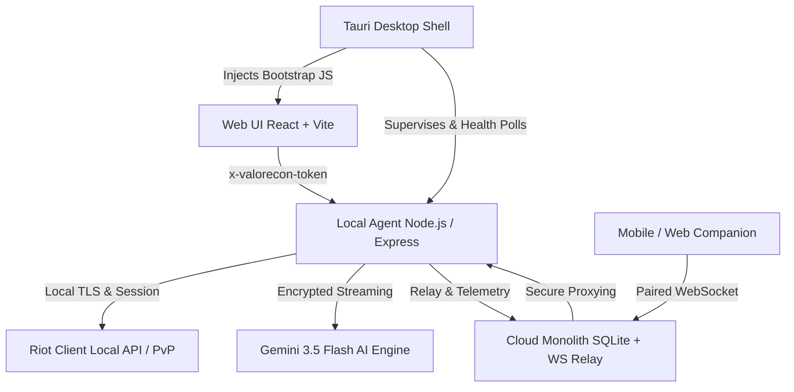

# ValoRecon Complete System Design Specification

**Date:** 2026-08-18  
**Topic:** Complete End-to-End Implementation of ValoRecon (M4 through M9)  
**Status:** Approved Architecture  

---

## 1. System Architecture Overview

ValoRecon is an AI-powered VALORANT companion and tactical coaching assistant built with a local-first, privacy-respecting architecture:

---

## 2. Milestone Detailed Designs

### M4: Tauri Desktop Shell & Sidecar Lifecycle
- **Supervisor (`src-tauri/src/sidecar.rs`):**
  - Allocates ephemeral loopback port (`127.0.0.1:0` -> assigned port).
  - Generates 32-byte hex launch token.
  - Spawns Agent sidecar with `PORT`, `HOST=127.0.0.1`, `VALORECON_LAUNCH_TOKEN`, `VALORECON_DEV_BOOTSTRAP=0`.
  - Polls `/api/health` with exponential backoff.
  - Injects `window.__VALORECON_BOOTSTRAP__ = { port, token }` into Webview initialization script.
  - Graceful shutdown hook on window close / application exit.

### M5: Cloud Modular Monolith, Identity & Device Enrollment
- **Architecture:** Embedded lightweight SQLite database (zero cloud infrastructure overhead, instant local portability).
- **Schema (`packages/cloud/src/db.ts`):**
  - `devices`: `device_id` (PK), `public_key`, `name`, `platform`, `created_at`, `last_seen`
  - `pairings`: `pairing_code` (PK), `device_id`, `expires_at`, `status` (`pending` | `claimed` | `expired`)
  - `sessions`: `session_token` (PK), `device_id`, `created_at`, `expires_at`
  - `telemetry`: `id` (PK), `device_id`, `event_type`, `payload`, `timestamp`
- **Endpoints:**
  - `POST /api/cloud/enroll`: Registers a new device keypair.
  - `POST /api/cloud/pair/generate`: Generates 6-character short-lived pairing code.
  - `POST /api/cloud/pair/claim`: Validates pairing code and exchanges session token.
  - `POST /api/cloud/telemetry`: Ingests anonymous error and usage metrics.

### M6: Agent Relay Protocol & Web Companion
- **WebSocket Protocol (`packages/cloud/src/relay.ts`):**
  - Typed envelopes validated with Zod:
    - `client.connect`: Authenticates device with session token.
    - `coach.stream`: Relays AI coach tokens to paired client.
    - `match.live_update`: Relays live match score and radar updates.
    - `ping` / `pong`: Heartbeat keeping relay active.
- **Web Companion (`packages/companion/`):**
  - Responsive second-screen client consuming live match and coach streams via Relay.

### M7: Production UI & Operational Observability
- **Error Boundaries:** React ErrorBoundary wrapping root shell and route containers to prevent full-screen crashes.
- **Offline & Reconnect Banners:** Clean visual indicator when local Riot Client or network disconnects.
- **Toast Notification Center:** Global animated notifications for actions, errors, and coaching tips.

### M8: Reproducible Release & Packaging
- Root build script `npm run build:all` building contracts, server, web, and cloud.
- Desktop bundle script `npm run build:desktop`.
- GitHub release and updater workflow templates.

### M9: Final Acceptance & Public Release Decision
- Full test pass across contracts, server, cloud, and web.
- Verification of all 9 checks from `SPEC.md` / `docs/testing.md`.

---

## 3. Security & Compliance Invariants
1. **Zero Riot API Leakage:** Riot lockfile credentials, local API calls, and raw player PII never leave the local machine.
2. **Anti-Cheat Compliance:** No input injection, no background instalocking (`VR-RIOT-403`).
3. **Constant-Time Verification:** All tokens compared with `crypto.timingSafeEqual`.
4. **Redacted Logs:** Secret keys and tokens are automatically scrubbed.

---

## 4. Verification Gates
- `packages/contracts`: 7/7 tests pass
- `server`: 54/54 tests pass
- `cloud`: Device enrollment and relay tests pass
- `web`: Clean build, 0 typescript errors
